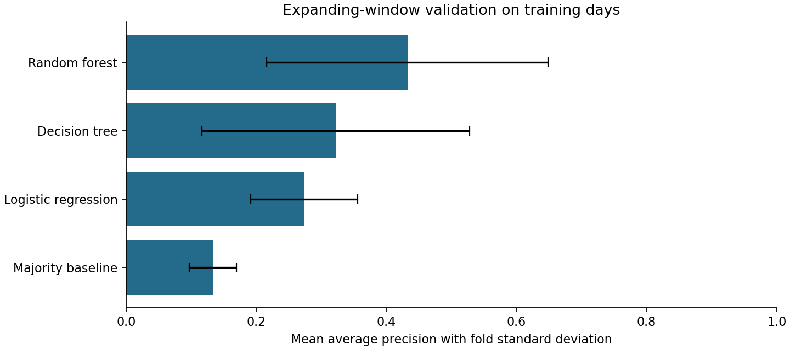
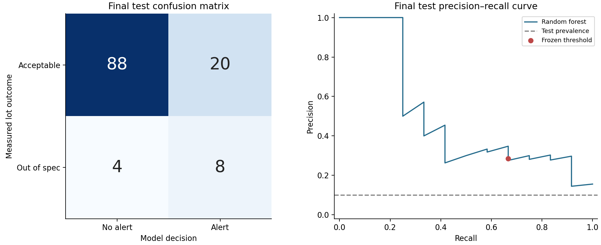

# Predicting bondline thickness out-of-spec risk

## Executive summary

**This project uses entirely synthetic data.** It demonstrates a manufacturing machine-learning workflow. It provides no evidence of predictive accuracy, causal process effects, or financial savings in an actual factory.

The project asks whether information available before a display-lamination lot starts can identify a later out-of-spec bondline thickness outcome. Late discovery of a thickness problem can consume material, production time, and inspection capacity. An early warning could help teams prioritize inspection and investigate tools before committing the next lot.

The dataset contains **30,000 production-unit records**, grouped into **600 lots of 50 units**, across **six fictional tools** and **100 days**. The modeling sample is 600 lots. Keeping units within their lot prevents the model from learning from a neighboring unit's outcome in a different evaluation period.

**Success criterion** — At least 80% recall while keeping the false-positive rate at or below 15% on a later test period.

The selected **Random forest** caught **8 of 12** out-of-spec test lots, missed **4**, and generated **20** false alarms among **108** acceptable lots. Recall was **66.7%** and the false-positive rate was **18.5%**. **The success criterion was not met.** These results support further investigation of the workflow, with substantial room to improve stability and alert precision.

## Start here

- Open the [executed notebook](bondline_oos_capstone.ipynb) for the full analysis and embedded plots.
- Read the [data dictionary](DATA_DICTIONARY.md) for every field, unit, and availability rule.
- Review the [plain-language findings](results/nontechnical_findings.md) for the operational interpretation.

## What is being predicted

One prediction is made immediately before each lot starts. The primary label, `lot_bondline_oos`, is 1 when the average of the lot's fifty measured unit means is strictly below or above its product-specific limits. Each unit mean averages five measured spatial sites. Values equal to a limit pass.

| Fictional product | Incoming OCA nominal | Bondline design center | Lot-mean acceptable range |
|---|---|---|---|
| P150 | 150 µm | 142 µm | 134.5–149.5 µm |
| P175 | 175 µm | 167 µm | 159.5–174.5 µm |

These study specifications were chosen for a consistent two-sided classification task. An acceptable lot mean can conceal individual-unit or site-level deviations. Bubble counts and uniformity are available for context and do not define the target. A real deployment must use its actual acceptance and sampling rules.

## Data and simulator

| File | Rows | Purpose |
|---|---|---|
| [lamination_units.csv](data/lamination_units.csv) | 30,000 | Unit timestamps, process telemetry, five thickness sites, uniformity, bubbles |
| [lamination_lots.csv](data/lamination_lots.csv) | 600 | Pre-lot features, history audit fields, later measured lot mean and primary label |
| [maintenance_events.csv](data/maintenance_events.csv) | 26 | Scheduled cleaning and calibration records |
| [manifest.json](data/manifest.json) | One manifest | Seed, data dimensions, predictor allowlist, SHA-256 file hashes |

Unit records join to lot context through `lot_id`. Use the lot table for the primary classifier. Repeating a lot's features and label across its fifty units would overstate the effective sample size.

Production spans January 5 through April 14, 2026, with timestamps expressed in UTC. All exported observation tables are synthetic. Unit and lot rows carry an explicit `is_synthetic` field. No personal information or factory records are used.

### Process assumptions

The [generator](generate_data.py) is the authoritative simulation specification and uses NumPy's fixed seed 20261106. It models the following effects.

- Incoming adhesive thickness varies by lot, with a gradual supply pattern and an additional +1.7 µm material shift beginning on day 72.
- Tool-specific offsets, autoregressive hidden drift, and accumulated wear shift thickness. Scheduled maintenance occurs every 18–23 production days, depending on tool. It resets the wear counter and retains 20% of the prior hidden drift.
- Higher applied pressure, roller force, temperature, and dwell reduce the modeled thickness. Faster motion and poorer vacuum can raise it. Pressure and temperature interact.
- Incoming glass bow contributes to thickness and spatial variation. Within-lot variation, 0.32 µm standard-deviation site measurement noise, and rare unobserved lot shocks keep the prediction imperfect.
- Four pre-lot measurement fields have independent 1.2% dropout probabilities. Initial tool histories are unavailable. Labels and downstream thickness measurements remain complete.

The temperature and process scales are plausible illustrative ranges. The compression response is a phenomenological statistical surrogate. It does not solve adhesive rheology, material-volume conservation, or contact mechanics. Coefficients, specifications, film choices, tool schedules, and defect rates are analyst assumptions.

The main simulated lot-level thickness deviation, in µm, combines 0.88 times the true incoming-film deviation, −125 times pressure deviation from 0.15 MPa, −0.60 times temperature deviation from 30 °C, −0.018 times force deviation from 300 N, +0.22 times speed deviation from 14 mm/s, −0.20 times dwell deviation from 12 seconds, +0.045 times absolute vacuum pressure above 35 Pa, +0.09 times bow deviation from 12 µm, +4.7 times normalized wear raised to 1.6, a −12 pressure–temperature interaction, tool offsets, drift, and lot noise. The source code contains the exact draws, clipping, site gradients, and measurement model.

Public 3M guidance gives context for OCA vacuum-lamination pressure and vacuum scales. The specific simulator ranges and coefficients are independently chosen study assumptions. [3M OCA 817X technical sheet](https://multimedia.3m.com/mws/media/1775425O/3m-optically-clear-adhesive-oca-817x-series.pdf)

## Preventing leakage

The prediction uses incoming-material measurements, planned recipe settings, pre-lot stabilization sensor checks, equipment counters, and released prior inspection history. The allowlist contains exactly 20 predictors. Current-lot metrology, during-production telemetry, bubble counts, uniformity, IDs, and inspection-release timestamps are excluded from model inputs.

The precheck occurs five minutes before the decision. Production timestamps occur in the following fifty minutes. Metrology is released 170 minutes after the decision. Historical features use the latest three same-tool lots whose metrology was released strictly before the new decision. The notebook independently reconstructs each historical mean and out-of-spec rate and checks the release timestamps.

The future test period simulates sequential scoring. Earlier test-period inspections become available for later test-period decisions after their release. Model weights and threshold stay fixed. This assumes an operating inspection feed. Simultaneously forecasting all future lots would require an alternative feature-availability design.

Numeric missing values are imputed with fitting-set medians, with missing indicators. Categorical encoding and numeric scaling are fitted inside the model pipeline. The notebook verifies unique IDs, complete lots, labels derived from unit metrology, disjoint chronological periods, and the absence of current-lot outcomes in predictors. This follows scikit-learn's pipeline and temporal-validation guidance. [Data leakage guidance](https://scikit-learn.org/stable/common_pitfalls.html), [TimeSeriesSplit documentation](https://scikit-learn.org/stable/modules/generated/sklearn.model_selection.TimeSeriesSplit.html)

## Modeling and validation

| Stage | Simulation days | Lots | How it is used |
|---|---|---|---|
| Training | 0–59 | 360 | EDA, four expanding-window validation folds, grid search, final model fit |
| Threshold selection | 60–79 | 120 | Select alert threshold for the already fitted winning model |
| Final test | 80–99 | 120 | Evaluate fixed model and threshold once |

Each cross-validation window spans ten days. A one-day gap separates fitting days from validation days and exceeds the inspection reporting delay. Folds group complete days and lots. All six tools appear in every period, so the experiment concerns future lots on known tools. It does not measure transfer to an unseen tool.

Models include a majority-class dummy baseline, logistic regression, a decision tree, and a random forest. GridSearchCV compares 26 hyperparameter combinations across the three trained families, using mean validation average precision. Candidate grids cover regularization, class weighting, depth, leaf size, and random-forest feature sampling. The full grid and fold results are exported.

| Model | Mean temporal-CV average precision | Fold standard deviation |
|---|---|---|
| Random forest | 0.432 | 0.216 |
| Decision tree | 0.322 | 0.206 |
| Logistic regression | 0.274 | 0.082 |
| Majority baseline | 0.133 | 0.036 |

Average precision evaluates ranking under class imbalance. Recall emphasizes catching affected lots. False-positive rate measures unnecessary alerts among acceptable lots. Precision measures review workload efficiency. F1 and ROC AUC provide supplementary comparisons.

The selected threshold is **0.4137**, chosen on the middle period by maximizing recall subject to a 15% false-positive-rate ceiling. Ties favor fewer false alarms and a higher threshold. It achieved 90.0% recall and 14.0% false-positive rate in that selection period. The model was trained on the first period only, with no later refit. Scores have not been calibrated as event probabilities.



## Findings and operational implications

| Final-test measure | Value |
|---|---|
| Out-of-spec lots | 12 of 120 |
| Caught out-of-spec lots | 8 |
| Missed out-of-spec lots | 4 |
| False alerts on acceptable lots | 20 |
| Recall | 66.7% |
| False-positive rate | 18.5% |
| Precision | 28.6% |
| Average precision | 0.505 |
| ROC AUC | 0.856 |

The 28 alerts would require review to identify eight affected lots, with twenty unnecessary reviews and four affected lots missed. The default majority-class decision catches zero affected lots. The selected classifier provides a useful risk ranking within this simulation, while the chosen operating point falls short of the project criterion.

The strongest permutation-importance signals were **incoming oca delta um, precheck pressure mpa, precheck vacuum pa abs**. The generator encodes effects for several process variables. These rankings describe the fitted model's use of simulated inputs. Correlation between pressure and roller force can distribute importance across related signals.



The middle-to-final-period deterioration shows that an operating threshold can lose effectiveness as the production mix and conditions change. The data include wear cycles and an incoming-material shift, but this experiment does not isolate the cause of the performance change.

A five-day block bootstrap produced a 95% recall interval of **40.0%–90.0%** and a false-positive-rate interval of **13.3%–24.3%**. With twelve positive test lots and only four five-day blocks, uncertainty remains substantial. Tool and product breakdowns are included with their sample counts. Some subgroups have very few affected lots. Recall and average precision are undefined and left blank for subgroups with no affected lots.

Each lot contains fifty units. The lot-mean label does not justify treating every unit in an affected lot as defective or calculating rescued units and savings from the alert count.

### Suggested next steps

1. Confirm the actual lot acceptance rule, product tolerances, inspection sampling plan, and measurement repeatability with manufacturing engineering.
2. Collect timestamped pre-lot measurements and metrology release times. Verify that each predictor exists when the production decision is made.
3. Validate the workflow on a later real-data period and across additional tool histories. Quantify sensitivity to different simulated coefficients, drift regimes, and missingness before making claims of robustness.
4. Run a shadow-mode inspection-prioritization pilot. Measure review capacity, missed defects, delays, scrap, and rework against the existing process. Any maintenance or recipe action requires controlled engineering validation.

## Reproduce the project

The delivered notebook includes all code-cell outputs and seven saved figure panels. It was executed from beginning to end using the included IPython runner. Independent regeneration matched the three supplied CSV file hashes. The runner executes every notebook code cell and saves rich output without requiring a notebook server. A conventional Jupyter server could not be launched in the authoring environment because local communication ports were unavailable.

The tested environment is Python 3.9.13 with the versions in [requirements.txt](requirements.txt). Use Python 3.9 to recreate these pinned package versions. Alternative package versions may change serialized CSV bytes or fitted model results. The executed environment is also recorded in [environment.json](results/environment.json).

From the extracted `display_lamination_capstone` folder, create an environment and install dependencies.

```bash
python3.9 -m venv .venv
source .venv/bin/activate
python -m pip install -r requirements.txt
```

Execute the complete notebook and regenerate the analysis outputs.

```bash
python run_notebook.py
```

Or open the notebook interactively in JupyterLab and use **Restart Kernel and Run All Cells**.

```bash
python -m jupyterlab bondline_oos_capstone.ipynb
```

Generate the dataset independently with the default fixed seed.

```bash
python generate_data.py
```

A changed seed should be written to a separate directory so the shipped manifest and notebook audit retain their fixed-seed meaning.

```bash
python generate_data.py --seed 123 --output-dir alternative_data
```

The notebook regenerates data into a temporary directory and compares hashes before modeling. If the data folder is absent, it recreates it. A mismatch stops execution. The generator performs no fitting or metric optimization. Model fitting, grid search, and permutation importance use a single worker and explicit seeds. README findings describe the shipped seed and environment.

## Project layout

```text
display_lamination_capstone/
  README.md
  DATA_DICTIONARY.md
  bondline_oos_capstone.ipynb
  generate_data.py
  run_notebook.py
  requirements.txt
  data/
    lamination_units.csv
    lamination_lots.csv
    maintenance_events.csv
    manifest.json
  results/
    figures/
    metrics.json
    environment.json
    frozen_model_choice.json
    model_comparison_cv.csv
    model_comparison_test.csv
    grid_search_results.csv
    temporal_fold_audit.csv
    split_manifest.csv
    threshold_selection.csv
    test_predictions.csv
    test_subgroup_metrics.csv
    test_block_bootstrap_intervals.csv
    permutation_importance.csv
    nontechnical_findings.md
```

## Capstone reference review

Both supplied examples, `capstone_example1_solution.zip` and `capstone_example2_solution.zip`, were accessible and reviewed. Their organization informed the clear notebook sections, EDA, model comparisons, interpretation, and executive-summary format. The assignment overview and five-category, 50-point grading rubric were also reviewed. The notebook includes a rubric-coverage table. All lamination simulation and analysis code in this package is original to this exercise.

The project uses relative notebook and figure links for repository upload.
